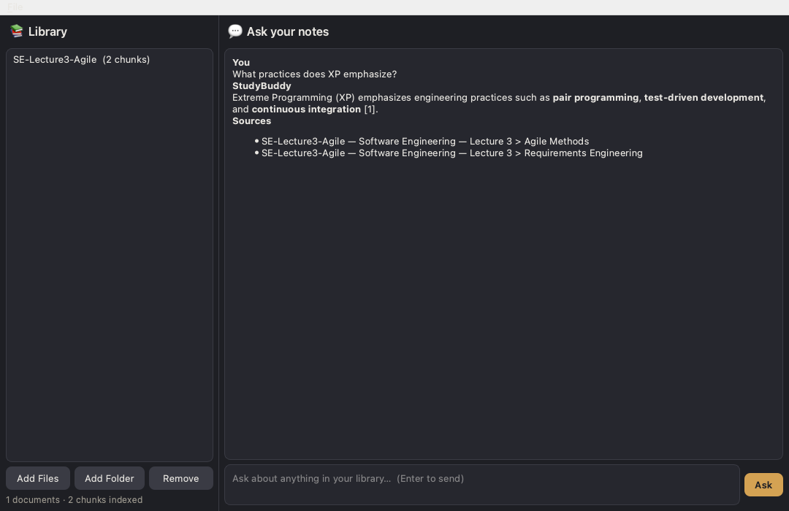

# StudyBuddy

A local-first desktop RAG study assistant. Point it at your lecture PDFs and
notes, and ask questions with answers grounded in — and cited back to — your
own material.



Evolution of a Jupyter-notebook experiment (fixed-size chunks, pure vector
search, hard-coded paths) into a proper desktop application with a modern
retrieval pipeline.

## Features

- **Desktop app** — PySide6/Qt; a real window next to your study PDFs, not a
  browser tab. Indexing and answer generation run on background threads.
- **Structured PDF parsing** — `pymupdf4llm` converts pages to Markdown
  (headings, tables, lists) so chunking can follow document structure.
  An optional **Docling** backend (better tables/complex layouts, opt-in
  extra) is selectable in Settings → PDF parser — see below.
- **Structure-aware chunking** — splits along the heading hierarchy first
  (each chunk keeps a `Lecture 3 > 3.2 Agile` breadcrumb), then size-splits
  within sections. Chunks get a contextual `Document/Section/Page` prefix
  baked into their embedding — the zero-LLM-call variant of contextual
  retrieval.
- **Hybrid retrieval** — vector search (sqlite-vec) **+** BM25 keyword search
  (SQLite FTS5) fused with Reciprocal Rank Fusion, then optional cross-encoder
  reranking (`bge-reranker-base`, ONNX).
- **Cited answers** — every answer lists the document + page/section
  sources, rendered as clickable links that open the PDF at the cited page
  (`file://…#page=N`).
- **Multi-turn chat** — follow-up questions send prior conversation turns
  to the LLM (bounded at 8 turns) while retrieval stays fresh per
  question; **New chat** resets the conversation.
- **Two providers** — Gemini API (free tier) by default, or fully-offline
  **Ollama** for zero-cloud usage. Switchable in Settings.
- **Gemini model fallback chain** — `auto` starts at `gemini-3.8-flash` and
  cascades down (3.7 → 3.6 → 3.5 → … → 2.5-flash-lite): each model has a
  separate quota, so a rate-limited/unavailable/empty tier hops instead of
  stalling. Pin a specific model in Settings and it is tried first, then
  still cascades through the rest of the chain. Override the chain via
  `STUDYBUDDY_GEMINI_FALLBACK_MODELS`.
- **Incremental indexing** — files are content-hashed; unchanged files never
  re-embed. Everything lives in one SQLite file under the OS app-data dir.
- **Local embeddings** — `all-MiniLM-L6-v2` via fastembed/ONNX. No PyTorch —
  keeps the packaged app small. Models cache after first download; retrieval
  then works offline.

## Download

Prebuilt apps for macOS and Windows are attached to
[GitHub Releases](https://github.com/mahmoudhaytham25/studybuddy-rag/releases) —
`StudyBuddy-macOS.dmg` and `StudyBuddy-windows.zip`, plus `SHA256SUMS-*.txt`
checksums.

The builds are unsigned, so the OS warns on first launch:

- **macOS** — Gatekeeper may call the app "damaged" or from an unidentified
  developer. Right-click → **Open** and confirm, or run
  `xattr -dr com.apple.quarantine /Applications/StudyBuddy.app`
  after copying it out of the DMG.
- **Windows** — on the SmartScreen prompt click **More info → Run anyway**.

## Install & run

To run from source instead:

```bash
git clone https://github.com/mahmoudhaytham25/studybuddy-rag
cd studybuddy-rag
python -m venv .venv && source .venv/bin/activate
pip install -e .
python -m studybuddy        # or: studybuddy
```

Requires Python ≥ 3.10 whose `sqlite3` supports loadable extensions
(standard python.org / Homebrew builds do; some pyenv/standalone builds
don't — `pip install pysqlite3-binary` as a fallback).

### Optional: Docling PDF backend

[Docling](https://docling-project.github.io) (IBM) recovers complex layouts
and tables more accurately than pymupdf4llm. It pulls in PyTorch (~2 GB
download), so it stays an opt-in extra and is never bundled into the
packaged releases:

```bash
pip install -e ".[docling]"
```

Then select **Docling** in Settings → PDF parser. Markdown is still emitted
per page via Docling's provenance tracking, so citation page numbers stay
exact. Switching parsers only affects files indexed afterwards — content
hashing means an unchanged file in the library is skipped, so remove a
document and re-add it to re-parse it.

## Getting answers

1. **File → Settings** — pick a provider:
   - **Gemini**: paste a free key from
     [Google AI Studio](https://aistudio.google.com) — model `auto` (newest
     flash first) or pick a specific one; failures cascade down the chain
   - **Ollama**: `ollama serve` + `ollama pull llama3.1:8b`, then Test connection
2. **Add Files / Add Folder** — drop in PDFs, Markdown or TXT notes.
   First run downloads the embedding model (~100 MB, cached afterwards).
3. Ask questions — answers stream in with `Sources` cited per response.

## How it works

```
PDF/MD/TXT ── pymupdf4llm ──▶ structured markdown
        │
        ▼  heading-aware split + contextual prefix          ┌─ sqlite-vec ──┐
chunks ─▶ embed (MiniLM-L6-v2, ONNX) ─▶ SQLite ─────────────┤               ├─▶ RRF
        │                                                    └─ FTS5 BM25 ──┘   fuse
        ▼                                                                        │
query ─▶ hybrid candidates ─▶ cross-encoder rerank ─▶ top-k ─▶ prompt ─▶ LLM
                                                               (Gemini | Ollama)
```

Layout:

```
studybuddy/
  core/            provider-agnostic pipeline (no Qt imports)
    documents.py   parse → ParsedDocument(pages, markdown)
    chunking.py    heading-aware splitter + contextual prefixes
    embeddings.py  fastembed wrapper (embed + rerank, lazy-loaded)
    store.py       SQLite + sqlite-vec + FTS5, RRF hybrid search
    index.py       hash-diffed incremental indexing
    rag.py         retrieval + prompt build + streamed answers, citations
    providers/     ChatProvider protocol · Gemini · Ollama
  ui/              PySide6: MainWindow, DocumentPanel, ChatPanel,
                   SettingsDialog, QThread workers
tests/             pytest suite (core fully covered; UI smoke via offscreen Qt)
```

## Tests

```bash
pip install -e ".[dev]"
pytest
```

68 tests — `.github/workflows/ci.yml` runs the same suite on every push/PR
with Qt offscreen.

## Packaging

```bash
pip install -e ".[package]"
pyinstaller packaging/studybuddy.spec --clean --noconfirm
```

produces `dist/StudyBuddy.app` (macOS) or a onefile `dist/StudyBuddy.exe`
(Windows). `scripts/build_mac.sh` additionally wraps the `.app` into a DMG.
ONNX models are deliberately not bundled — fastembed downloads them into the
app-data dir on first run. `.github/workflows/release.yml` builds both
artifacts and publishes them to GitHub Releases on `v*` tags.

## Stack

Python · PySide6 · PyMuPDF/pymupdf4llm (+ optional Docling) · fastembed (ONNX) · sqlite-vec ·
SQLite FTS5 · google-genai · Ollama · PyInstaller · pytest · GitHub Actions
